# Sprint 4 - Spring Boot Tasca 2 - Nivell 3

API REST con Spring Boot para gestionar comandas de frutas realizadas por clientes, utilizando persistencia con MongoDB, documentos embebidos y Docker Compose.

## Tecnologías utilizadas

- Java 21
- Spring Boot 4.1.1
- Spring Web MVC
- Spring Data MongoDB
- MongoDB 8.0
- Jakarta Validation
- Maven
- JUnit
- Mockito
- MockMvc
- Docker y Docker Compose
- IntelliJ IDEA
- Git
- GitHub

## Funcionalidades

- Crear comandas indicando el cliente, la fecha de entrega y las frutas.
- Listar todas las comandas.
- Buscar comandas por ID.
- Actualizar comandas.
- Eliminar comandas.
- Almacenar las frutas y sus cantidades.
- Validar que el cliente tenga un nombre.
- Comprobar que la fecha de entrega sea posterior al día actual.
- Exigir al menos una fruta en cada comanda.
- Validar que cada fruta tenga nombre y una cantidad positiva.
- Persistencia con MongoDB y Spring Data MongoDB.
- Uso de DTOs para las peticiones y respuestas.
- Gestión global de errores con respuestas JSON y códigos HTTP.

## Arquitectura

- **Controller**: gestiona las peticiones y respuestas HTTP.
- **Service**: contiene la lógica de negocio.
- **Repository**: gestiona el acceso a los datos mediante Spring Data MongoDB.
- **Model**: representa las clases `Order` y `OrderItem`.
- **DTO**: controla los datos de entrada y salida de la API.
- **Exception**: contiene las excepciones personalizadas y la gestión global de errores.

## Persistencia

MongoDB como base de datos principal, ejecutada mediante Docker Compose.

Las comandas se representan mediante documentos `Order`, que contienen el nombre del cliente, la fecha de entrega y una lista de productos.

Cada producto se representa mediante `OrderItem`, almacenado como documento embebido dentro de la comanda.

Ahora, no se utilizan entidades JPA ni relaciones SQL.

La base de datos utiliza un volumen de Docker para conservar los datos entre reinicios de los contenedores.

Los tests de integración utilizan una base de datos MongoDB de pruebas separada de la principal.

## Reutilización y adaptación de código

- He aprovechado la estructura y los patrones de los otros niveles, adaptándolos a los nuevos requisitos y a MongoDB.

- Mantenida la separación entre `Controller`, `Service`, `Repository`, `Model`, `DTO` y `Exception`, y el funcionamiento general de las operaciones CRUD.

- También he reutilizado los enfoques de validación, gestión global de excepciones, pruebas automatizadas con JUnit, Mockito y MockMvc.

Adaptaciones principales:

- **Persistencia**: sustituir Spring Data JPA por Spring Data MongoDB.
- **Repositorio**: utilizar `MongoRepository` en vez de `JpaRepository`.
- **Modelo**: creación de `Order` y `OrderItem` para representar comandas con productos embebidos, en lugar de entidades relacionadas.
- **DTOs**: adaptación de las entradas y salidas a los datos de una comanda.
- **Service y Controller**: he seguido la misma forma de trabajar que en los niveles anteriores, adaptando los métodos para gestionar las comandas.
- **Excepciones**: adaptada la gestión de errores a las validaciones y búsquedas de comandas.

Asi he evitado crear de cero toda la arquitectura, aprovechando los patrones anteriores, modificando las partes relacionadas con el nuevo modelo de datos y persistencia.

## Pruebas

Comprobado de forma manual y automática.

### Manuales

- Crear comandas con distintas frutas y cantidades.
- Listar las comandas existentes.
- Consultar comandas por ID.
- Actualizar el cliente, la fecha y los productos de una comanda.
- Eliminar comandas.
- Comprobar la respuesta `404 Not Found` cuando una comanda no existe.
- Comprobar las validaciones de entrada y los errores HTTP.
- Verificar la persistencia de documentos con productos embebidos en MongoDB.
- Ejecutar Spring Boot y MongoDB conjuntamente mediante Docker Compose.
- Comprobar el funcionamiento del CRUD con ambos servicios dentro de Docker.

### Automáticos

- Tests del modelo `Order`.
- Tests de servicios con JUnit y Mockito.
- Tests de la capa web con MockMvc.
- Tests de validación y gestión de errores.
- Tests de integración del repositorio con MongoDB.

## TDD

Primero he creado tests para definir el comportamiento y después las refactorizaciones.

He utilizado tests de servicio, de controlador y de integración para comprobar el funcionamiento de la aplicación.

## Docker

Incluye un `Dockerfile` multi-stage y un archivo `compose.yaml` para ejecutar la API junto a MongoDB.

La primera etapa utiliza Maven 3.9 y Java 21 para compilar la aplicación y generar el JAR.

La segunda etapa utiliza Java 21 JRE para ejecutar el JAR, sin incluir Maven en la imagen final.

Docker Compose inicia los servicios:

- **mongodb**: MongoDB 8.0, accesible desde el ordenador en `localhost:27017`.
- **api**: aplicación Spring Boot, accesible en `http://localhost:8080`.

La comunicación interna entre contenedores utiliza `mongodb:27017`.

MongoDB incorpora un `healthcheck` y la API espera a que la base de datos esté preparada antes de arrancar.

### Construir y arrancar los contenedores

Desde la carpeta `fruit-order-api`:

```powershell
docker compose up -d --build
```

Comprobar su estado:

```powershell
docker compose ps
```

Consultar los logs de Spring Boot:

```powershell
docker compose logs api --tail=50
```

Para detener los contenedores sin eliminar los datos:

```powershell
docker compose down
```

> No usar `docker compose down -v` si se quieren conservar los datos, porque elimina los volúmenes gestionados por Docker Compose.

## Ejecución de la aplicación

- Desde IntelliJ IDEA, con MongoDB disponible.
- Mediante Maven, desde la carpeta `fruit-order-api`.
- Ejecutando el JAR generado.
- Mediante Docker Compose, que ejecuta conjuntamente Spring Boot y MongoDB.
- Realizando peticiones HTTP desde PowerShell o `curl.exe`.

Para ejecutar la API desde IntelliJ, la conexión predeterminada apunta a `localhost:27017`.

Para ejecutarla dentro de Docker, Compose proporciona la variable de entorno `MONGODB_URI` con la dirección interna `mongodb://mongodb:27017/fruit_orders`.

## UML
